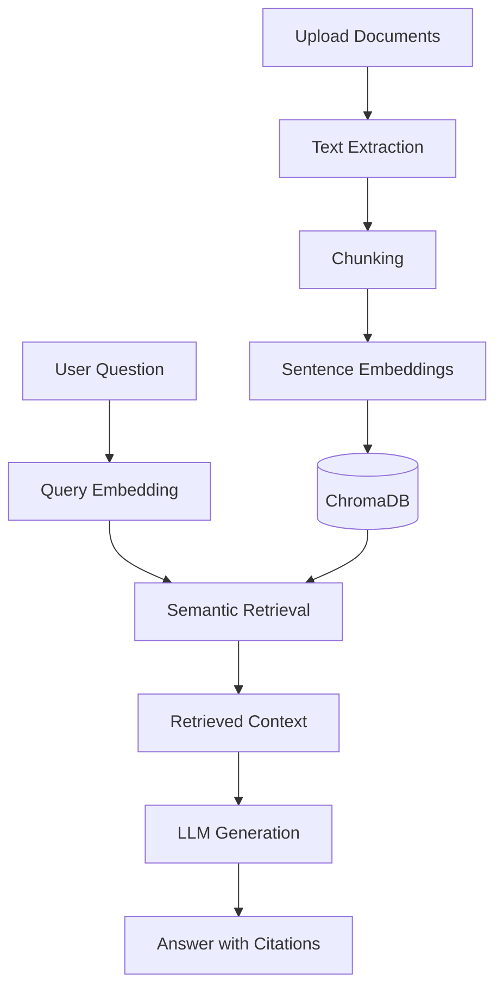

<div align="center">

# 🧠 KnowFlow AI

### Persistent Knowledge Assistant

**Retrieval-Augmented Generation · Semantic Search · Document Intelligence**

An AI-powered document assistant that retrieves relevant information from uploaded documents and generates contextual answers with source citations.

<br/>


</div>

---

## Overview

KnowFlow AI is a full-stack document question-answering application built around Retrieval-Augmented Generation (RAG).

Users can upload documents, retrieve semantically relevant passages, and ask questions grounded in their own content. The application combines vector search with language-model generation to produce contextual answers and source references.

The project explores how document retrieval, embedding models, and LLM integration can be combined into a practical AI assistant.

## Features

- **Document ingestion:** upload supported PDF, DOCX, Markdown, and TXT files.
- **Text processing:** extract document text and split it into overlapping chunks.
- **Semantic embeddings:** encode document passages using Sentence Transformers.
- **Vector search:** store and retrieve embeddings with ChromaDB.
- **Contextual question answering:** generate responses using retrieved document passages.
- **Source citations:** associate answers with retrieved source references.
- **Document management:** inspect and delete indexed documents.
- **Conversation history:** maintain question-and-answer history using SQLite.
- **Dashboard:** view document, chunk, and query-related information.

## How It Works



## Architecture

### Backend

- **FastAPI** — HTTP API and application endpoints.
- **Sentence Transformers** — local text embedding generation.
- **ChromaDB** — persistent vector storage and similarity search.
- **SQLite** — conversation history and lightweight application data.
- **LLM providers** — configurable generation through supported providers.

### Frontend

- **Next.js 15 App Router**
- **TypeScript**
- **Tailwind CSS**
- **React Query**
- **Framer Motion**
- **react-markdown**

## Retrieval Pipeline

KnowFlow AI follows a typical RAG workflow:

1. Extract text from an uploaded document.
2. Split the extracted content into overlapping chunks.
3. Generate vector embeddings for each chunk.
4. Persist the embeddings and associated metadata in ChromaDB.
5. Embed the user's question.
6. Retrieve relevant chunks through vector similarity search.
7. Send the retrieved context to the configured language model.
8. Return the generated answer with source references.

This approach grounds responses in retrieved document content rather than relying exclusively on the language model's internal knowledge.

## Embedding and Storage

The application uses a Sentence Transformers embedding model, with `all-MiniLM-L6-v2` as the legacy/default model configuration.

ChromaDB stores document embeddings and supports similarity-based retrieval. The embedding configuration must remain consistent between indexing and querying.

The LLM provider is configurable, allowing supported local or hosted models to be used for answer generation.

## Getting Started

### Prerequisites

- Python 3.11
- Node.js and npm
- Git
- A supported LLM provider configured for answer generation

### 1. Clone the repository

```bash
git clone YOUR_KNOWFLOW_REPOSITORY_URL
cd YOUR_KNOWFLOW_PROJECT_FOLDER
```

### 2. Set up the backend

Navigate to the backend directory:

```bash
cd backend
python -m venv .venv
```

Activate the environment on Windows:

```powershell
.\.venv\Scripts\Activate.ps1
```

Install the dependencies using the backend dependency file:

```bash
pip install -r requirements.txt
```

Start the API using the entry point configured in the project. For example, if the application instance is `app.main:app`:

```bash
uvicorn app.main:app --reload
```

The API is commonly available at:

`http://127.0.0.1:8000`

FastAPI documentation is available at:

`http://127.0.0.1:8000/docs`

### 3. Set up the frontend

Open another terminal and navigate to the frontend directory:

```bash
cd frontend
npm install
npm run dev
```

Open the local development URL printed by Next.js, commonly:

`http://localhost:3000`

Adjust the directory names and commands if your repository uses a different structure.

## Configuration

Configure the variables expected by your application before starting it.

Depending on the selected provider, these may include:

- `LLM_PROVIDER`
- `EMBEDDING_MODEL`
- `OPENAI_MODEL`
- Ollama connection and model settings
- Generation limits and timeout settings

Use the project's example environment file if one exists. Keep API keys and other secrets out of GitHub.

## Current Scope and Limitations

- Scanned PDFs requiring OCR are not supported by the current extraction pipeline.
- Answer quality depends on document extraction, chunking, retrieval relevance, and the selected LLM.
- Authentication and multi-user access should not be assumed unless implemented.
- Production deployment, security controls, and evaluation should be assessed separately from local development functionality.

## Technology Stack

| Layer | Technologies |
|---|---|
| API | Python, FastAPI |
| Embeddings | Sentence Transformers |
| Vector database | ChromaDB |
| Language models | Configurable local or hosted providers |
| Application data | SQLite |
| Frontend | Next.js, React, TypeScript |
| UI | Tailwind CSS, Framer Motion |
| Data retrieval | Semantic vector search |

## Future Improvements

Potential areas for further development include:

- OCR support for scanned documents.
- Retrieval evaluation using a curated question-answer dataset.
- Streaming responses.
- Authentication and multi-user document isolation.
- Containerization and automated testing.
- Hybrid retrieval combining vector similarity and keyword search.

These are possible extensions, not claims about currently implemented features.

## Author

**Alaa Sekiou**  
Master's student in Artificial Intelligence — USTHB

[GitHub Profile](https://github.com/alaasek)

